<!-- Cabeçalho animado (assets/header.svg) -->

  

  

  
  
  
  

 

## 🎨 Sobre mim

Oi! Eu sou a **Camilla**, designer de **social media** e **web design** no Rio de Janeiro.
Transformo ideias em conteúdo visual para redes sociais, com cuidado em cada detalhe: tipografia, cor e composição.

> ✦ *Cada peça deve transmitir uma mensagem, não só preencher o feed.*

- 🎓 Estudante de **Bacharelado em Ciências Matemáticas** na **UFRJ**
- 📱 Crio conteúdo para marcas, profissionais autônomos e criadores
- 💻 Desenvolvo sites em HTML, CSS e JavaScript
- 📍 Rio de Janeiro, Brasil

 

## ✨ O que eu faço

  
  

 

## 🌐 Sites que eu criei

  
  
  

 

## 🛠️ Ferramentas

  
  
  
  
  
  
  

 

## 📊 Meu GitHub

  
  

 

## 🐍 A cobrinha dos meus commits

  <picture>
    <source media="(prefers-color-scheme: dark)" srcset="https://raw.githubusercontent.com/ccpaschoal/ccpaschoal/output/snake-dark.svg">
    <source media="(prefers-color-scheme: light)" srcset="https://raw.githubusercontent.com/ccpaschoal/ccpaschoal/output/snake.svg">
    
  </picture>

 

## 💌 Vamos conversar?

  Tem uma ideia ou um projeto? Vai ser um prazer pensar em como transformá-lo em conteúdo.

  
  
  

  

