<!-- As imagens ficam em assets/ e são geradas com a paleta do portfólio. -->

 

<picture>
  <source media="(prefers-color-scheme: dark)" srcset="https://raw.githubusercontent.com/ccpaschoal/ccpaschoal/main/assets/t-sobre-dark.svg">
  
</picture>

  

<picture>
  <source media="(prefers-color-scheme: dark)" srcset="https://raw.githubusercontent.com/ccpaschoal/ccpaschoal/main/assets/t-sites-dark.svg">
  
</picture>

  
  
  

 

<picture>
  <source media="(prefers-color-scheme: dark)" srcset="https://raw.githubusercontent.com/ccpaschoal/ccpaschoal/main/assets/t-github-dark.svg">
  
</picture>

  
  

<picture>
  <source media="(prefers-color-scheme: dark)" srcset="https://raw.githubusercontent.com/ccpaschoal/ccpaschoal/output/snake-dark.svg">
  
</picture>

  

<picture>
  <source media="(prefers-color-scheme: dark)" srcset="https://raw.githubusercontent.com/ccpaschoal/ccpaschoal/main/assets/t-contato-dark.svg">
  
</picture>

  
  
  
  

<picture>
  <source media="(prefers-color-scheme: dark)" srcset="https://raw.githubusercontent.com/ccpaschoal/ccpaschoal/main/assets/footer-dark.svg">
  
</picture>
